##  Service record

`LEAD FRONTEND ENGINEER` — Barikoi Technologies, Dhaka · `MAR 2026 – PRESENT`
`SOFTWARE ENGINEER - FRONTEND` — Barikoi Technologies, Dhaka · `NOV 2022 – FEB 2026`
`EDUCATION` — BBA in Finance · Mohammadpur Central University College · `JUL 2014 – DEC 2019`

##  Field log · selected work

| Record | Scale | Mechanism |
|:--|:--|:--|
| `PICKABOO` | `1M+ MOBILE · 500K+ REGISTERED · 10K+ TX/DAY` | `NEXT.JS APP ROUTER REBUILD · 10+ PAYMENT METHODS · 30% ORGANIC GROWTH` |
| `AKG SALES LIVE` | `2.8M OUTLETS · 4,500+ REPS · 2,000+ UPDATES/S` | `LIVE SALES MAP · 25% FEWER ROUTE DEVIATIONS` |
| `VERIFY` | `13+ FINANCIAL INSTITUTIONS` | `CONTACT POINT VERIFICATION · BANGLADESH FINTECH AWARD 2023` |
| `GEO-FIBER` | `46,500+ KM FIBER` | `DECK.GL DASHBOARD · SERVER-SIDE KMZ/KML PIPELINE` |
| `JTI` | `~6K LIVE USERS` | `LIVE ROUTES, OUTLETS, FIELD FORCE · TURF.JS GEO-REPORTING` |
| `SALESKOI` | `RETAIL SAAS PLATFORM` | `MQTT LIVE UPDATES · TANSTACK TABLE · WEB WORKERS` |
| `DROPX` | `LOGISTICS OPERATIONS` | `DECK.GL FLEET TRACKING OVER MQTT AND PUSHER` |

### Field notes

- `PICKABOO` — `40% FEWER API CALLS (RTK QUERY + OPTIMISTIC UPDATES) · NEXTAUTH SOCIAL + OTP LOGIN · JSON-LD + SITEMAP SEO · MAP-BASED ADDRESS SELECTION`
- `AKG` — `SERVER-SIDE PROXY ROUTES · JWT + RBAC · BATCHED MQTT UPDATES · MEMOIZED COMPONENTS · RTK QUERY CACHING`
- `VERIFY` — `VERSIONED API HANDSHAKE · MULTI-STATE WORKFLOW (PENDING / APPROVED / REJECTED) · MODULAR REACT + TS ARCHITECTURE`
- `GEO-FIBER` — `MULTER 100MB UPLOADS · UNZIPPER · @TMCW/TOGEOJSON · PUSHER STREAMING · SENTRY + PM2`
- `JTI` — `TLP + PERIOD-COMPARISON VIEWS · ANT DESIGN CHARTS · NUQS URL-DRIVEN FILTERS`
- `SALESKOI` — `EXCEL EXPORTS · PROD / STAGING / REVIEW CI · ROLE-BASED + OTP · REACT-BKOI-GL MAP VIEW · COMLINK WORKERS · IDB CACHE · CMDK PALETTE`
- `DROPX` — `MERCHANT + ADMIN PANELS · RIDERS, MERCHANTS, AGENTS · DELIVERY RATES · SUPPORT TICKETING · EXCEL / PDF EXPORTS`

##  Equipment

**Frontend**

  
  
  
  
  
  
  
  
  
  
  
  
  
  
  
  
  
  
  
  
  
  

<code>REACT · NEXT.JS · TYPESCRIPT · JAVASCRIPT ES6+ · REACT NATIVE · PWA · EXPO · REDUX TOOLKIT · RTK QUERY · REACT ROUTER · ZOD · TANSTACK · HTML5 · CSS3 · TAILWIND CSS · ANT DESIGN · MATERIAL UI · SHADCN · VUE.JS · SVELTE · ANGULAR · BOOTSTRAP 5 · SASS</code>

**Geospatial & Visualization**

  
  
  
  
  
  
  
  
  

<code>MAPLIBRE · MAPBOX · DECK.GL · KEPLER.GL · THREE.JS · WEBGL · TURF.JS · TILESERVER-GL · MARTIN · KML/KMZ · GEOJSON</code>

**Real-Time Communication**

  
  
  
  

<code>MQTT · PUSHER · SOCKET.IO · WEBSOCKETS · LIVE LOCATION TRACKING · EVENT-DRIVEN ARCHITECTURES</code>

**Cloud Platforms**

  
  
  
  
  
  
  
  

<code>AWS · GCP · AZURE · CLOUDFLARE · VERCEL · NETLIFY · HEROKU · FIREBASE HOSTING</code>

**DevOps & CI/CD**

  
  
  
  
  
  
  
  
  

<code>DOCKER · LINUX · UBUNTU · GITHUB ACTIONS · JENKINS · GRAFANA · JIRA · PM2 · NGINX · SSL CONFIGURATION</code>

**Testing & Quality**

  
  
  
  
  
  
  
  

<code>JEST · VITEST · REACT TESTING LIBRARY · SONARQUBE · PLAYWRIGHT · K6 · POSTMAN · E2E TESTING · SENTRY · ACCESSIBILITY (A11Y) · CODE REVIEWS</code>

**Payment Integrations**

  
  
  
  

<code>STRIPE · BKASH · NAGAD · AAMARPAY · SSLCOMMERZ · EMI / CARDLESS EMI / COD · MULTI-STEP CHECKOUT</code>

**Backend**

  
  
  
  
  
  
  
  
  
  
  

<code>NODE.JS · EXPRESS.JS · HONO · MONGODB · REDIS · GO · RUST · BUN · REST APIS · SWAGGER · JWT · AUTH0 · MVC ARCHITECTURE · FIREBASE · SERVER-SIDE PROXY ROUTES</code>

**AI-Assisted Engineering**

  
  
  
  
  
  
  

<code>PI-NATIVE · PI CODING AGENT · CLAUDE CODE · ANTHROPIC · OPENAI · CHATGPT · DEEPSEEK · CURSOR · PROMPT-DRIVEN DEVELOPMENT · AI OUTPUT VALIDATION</code>

**Documentation & Tooling**

  
  
  
  
  
  
  
  
  
  
  
  
  
  
  
  
  
  
  
  
  
  

<code>DOCUSAURUS · STORYBOOK · FIGMA · GIT · GITHUB · VITE · WEBPACK · ROLLUP · BABEL · ESLINT · PRETTIER · PNPM · MARKDOWN · JSON · NPM PACKAGE DEVELOPMENT · SUBLIME TEXT · VIM · VS CODE · GHOSTTY · HOMEBREW · BRAVE · DISCORD</code>

##  Open source · depot

### [pi-native](https://github.com/nurmdrafi/pi-native) — Pi coding-agent harness

A performance-focused Pi coding-agent harness with native Rust tools, fail-closed permission gates, and token-efficient context management.

`AGENT-HARNESS · RUST · PERMISSION GATES · TOKEN OPTIMIZATION · TUI · SUBAGENTS · SKILLS · EXTENSIONS` — `MACOS · LINUX · MIT`

### [bkoi-gl](https://www.npmjs.com/package/bkoi-gl) — Barikoi Maps SDK

A WebGL interactive maps library for Barikoi maps and APIs, wrapped for React, Next.js, Nuxt, Vue, Angular, Svelte, and vanilla JS. 17 releases across 4 major versions.

`WEBGL · MAPLIBRE GL · SDK` — `REACT · NEXT.JS · NUXT · VUE · ANGULAR · SVELTE · VANILLA JS`

### [react-bkoi-gl](https://www.npmjs.com/package/react-bkoi-gl) — Barikoi Maps for React

A React library for Barikoi Maps with interactive components, markers, popups, and controls. 14 releases across 3 major versions.

`REACT · COMPONENTS · MARKERS · POPUPS · CONTROLS` — `BKOI-GL WRAPPER`

### [barikoiapis](https://www.npmjs.com/package/barikoiapis) — Barikoi Location Services SDK

Official TypeScript/JavaScript SDK for Barikoi Location Services — geocoding, search, and mapping APIs.

`TYPESCRIPT · JAVASCRIPT · SDK` — `BARIKOI LOCATION SERVICES`

### [geo-polyline-tools](https://www.npmjs.com/package/geo-polyline-tools) — Polyline utilities

Utility functions to encode and decode polyline coordinates, with GeoJSON LineString support. 7 releases.

`POLYLINE ENCODE / DECODE` — `GEOJSON · LINESTRING`

### [barikoi-map-widget](https://www.npmjs.com/package/barikoi-map-widget) — Embeddable map widget

A customizable map widget built with React, designed for seamless integration with Barikoi's map services. 4 releases.

`REACT · EMBEDDABLE WIDGET` — `CUSTOMIZABLE`

### [barikoiapis-golang](https://pkg.go.dev/github.com/barikoi/barikoiapis-golang) — Barikoi SDK for Go

Go SDK for Barikoi Location Services. 7 tagged versions.

`GO · SDK` — `BARIKOI LOCATION SERVICES`

##  Transmissions

`MEDIUM` — 8 technical articles → [medium.com/@nurmdrafi](https://medium.com/@nurmdrafi)
`STACK OVERFLOW` — 539+ reputation · 27 answers → [stackoverflow.com/users/15497939/nurmdrafi](https://stackoverflow.com/users/15497939/nurmdrafi)

##  Signal

[Portfolio](https://nurmdrafi.vercel.app/) · [LinkedIn](https://linkedin.com/in/nurmdrafi) · [GitHub](https://github.com/nurmdrafi) · [Medium](https://medium.com/@nurmdrafi) · [Stack Overflow](https://stackoverflow.com/users/15497939/nurmdrafi) · [nurmdrafi2014@gmail.com](mailto:nurmdrafi2014@gmail.com)

---

